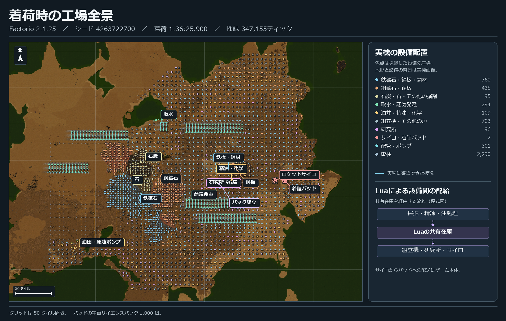

# How to Have AI Beat Factorio Within 1 Hour and 40 Minutes

[日本語](README.md) · [简体中文](README.zh-Hans.md)

Release candidate **v0.2.0-rc.1** by Factory Launch Project. It automates the first satellite launch and cargo delivery from a fresh map in **Factorio 2.1.25, Steam build 88022**, base game, seed **4263722700**. The project best is **1:34:05.300** to complete rocket ascent and **1:34:14.783** to receive 1,000 space science packs. The delivery is **16 minutes 35.233 seconds** faster than the earlier **1:50:50.017** on the same seed and build, measured in game time. [Timing comparison](evidence/timing-history.json) · [Release verification](evidence/release-verification.json)

**ChatGPT did nearly all the work**, including design, implementation, testing, verification, and documentation. The project user set the goals, supplied speedrun references, proposed improvements, and checked the game screen and achievements.

At the time of this record, the chat was using **GPT-6.2 Sol in Ultra mode**. The user reported using **about 43% of the account's weekly allowance** overall. Project-only usage was not measured. From **November 22 to 25, 2026 (JST)**, the logs show **about 690 Factorio starts (693)** for trials, replays, and inspections, including **107 scripted test-mode starts** and the release candidate replay. [Breakdown and audit data](evidence/development-and-validation.json)

## What was measured

| Run | Rocket ascent complete or victory screen | 1,000 space science packs confirmed in the cargo landing pad |
| --- | ---: | ---: |
| Release candidate headless replay | **1:34:05.300** · tick 338,718 | **1:34:14.783** · tick 339,287 |
| Earlier headless baseline | 1:34:07.583 · tick 338,855 | 1:34:17.067 · tick 339,424 |
| Visible automation with camera and capture instrumentation | **1:36:16.417** · tick 346,585 | **1:36:25.900** · tick 347,154 |
| Manual launch from the included save | **1:37:30** on the victory screen | **1,000** after selecting **Continue** |
| Earlier Steam achievement retest from a separate save | **1:38:14** on the victory screen | **1,000** after selecting **Continue** |

The automation times and ticks start at world creation. Two fresh-map headless runs matched all 223 logged events and the production and consumption totals. The visible replay uses a separate capture-enabled route, with an on-screen timer that starts later. Both manual times are victory screen readings and include the automated preparation before the respective saves. Elapsed PC time is recorded separately. [Two fastest runs](evidence/iron-allocation-55-comparison.json) · [Earlier headless replays](evidence/replays.json) · [Visible capture evidence](evidence/visible-capture.json)



The overview has Japanese labels. The shared-stock arrows show where the Lua route supplies equipment and materials across the factory. Pipe markings show physical connections.

## Run the fixed replay

Use Windows, the installed Steam build specified above, and Python 3.11 or newer. The launcher uses the standard library. Extract the kit to a writable directory and open PowerShell there. Keep the existing folder names. Run `python --version` to check the interpreter. If the command opens the Microsoft Store, use the full path to your installed `python.exe`.

```powershell
python ./check_kit.py
python ./4263722700_AI別運用/operate.py replay --id replay-01
python ./4263722700_AI別運用/operate.py status --id replay-01
python ./4263722700_AI別運用/operate.py practice
```

- **Preflight.** `check_kit.py` checks the installed build, the pinned inputs for both routes and the included save's SHA-256. For a nonstandard Steam library, pass `--factorio "D:\Games\Factorio\bin\x64\factorio.exe"` to the preflight, `replay` and the visible runner's `check` and `visible` commands.
- **Replay.** Assign an unused ID for each attempt. The wrapper generates the fixed map locally, runs the game and validates the final evidence against the reference. Run `status` in another terminal to inspect the same ID while it is active.
- **Verify.** A passing replay returns exit code **0** with `state: matched`, `completed: true`, one rocket, one satellite, `landing_pad_space_science: 1000` and `delivery_world_tick: 339287`. The verifier also checks the input hashes and ordered event ticks.
- **Recover.** Exit code **2** from `replay` or `status` means the run or its evidence is pending. Keep inspecting the same ID while the run is alive. If it has stopped, inspect the launch and verification logs before classifying it. Exit code **1** means failure, including a version or hash mismatch. Correct the cause before trying again with a fresh ID.
- **Practice.** The command returns four mock cases for interpreting logs, with the grading keys omitted. An AI that can only read logs can still classify these examples or diagnose a run another person started. The original fixed replays and mock-log checks used Codex. The development record tracks text-only log classification and full replay separately. [Development record](運用と開発の記録.md) · [Test environment and tools](evidence/environment.json)

For guided viewing, use the separate capture-enabled runner from the kit root.

```powershell
python "./画面付き走行/run_route.py" check
python "./画面付き走行/run_route.py" visible demo-01
python "./画面付き走行/run_route.py" report demo-01 --require-delivery
```

Steam may ask you to confirm the custom arguments for that trial. At the victory screen, choose **Continue**. With `--require-delivery`, exit code **0** and `delivery-verified` require the ordered launch, victory and delivery events, exactly 1,000 packs in the pad and arrival before tick 360,000. Exit code **2** means evidence is pending. Keep checking the same run name. Exit code **1** means inconsistent evidence, failure or a missed cutoff. The standard report's `goal-met` can appear at victory while the cargo is in flight. Use the headless wrapper for exact reference checks. [Delivery check results](evidence/visible-delivery-report.json)

The capture correction supports both `position` and `drill` when locating mining sites. After delivery, the run's `script-output` folder contains native PNGs of the whole factory, labs and silo area, plus `factory-layout.json`. A new-map run of the retitled kit produced all three captures at delivery. [Run and capture records](evidence/development-and-validation.json) · [Earlier replay and capture correction](evidence/visible-zip-replay.json)

## Manual launch and Steam achievement check

Copy the pre-launch save ZIP into `%APPDATA%\Factorio\saves`, the default save directory on Windows. In Steam Factorio 2.1.25 (build 88022), enable only the base game and open the save from **Single player → Load game**. Open the rocket silo beside the character. Confirm the rocket is at 100%, one satellite is loaded, and automatic launch is off. Click **Launch**, then choose **Continue** on the victory screen. Open the cargo landing pad east of the silo, using remote view (`M`) if needed. [Pre-launch save](saves/4263722700-manual-neutral-ready.zip)

The included save starts with zero stored player records. A manual test showed **1:37:30** on the victory screen and **1,000** space science packs in the landing pad. A fresh Steam unlock with this save remains unverified. [Manual launch evidence](evidence/neutral-manual-handoff.json)

A separate test on the earlier checkpoint verified that **There is no spoon** unlocked again on Steam at **2026-11-24 21:52 JST** following an account-owner-authorized reset. If the achievement is still unearned on your account, check its status before launch and compare the in-game notification with Steam after launch. [Earlier Steam retest](evidence/steam-recheck.json) · [Factorio achievement conditions](https://wiki.factorio.com/Achievements#Disabling_achievements)

## How the route was developed

The project progressed from a one-iron-plate connection test on 2.1.24 to repeatable production runs, then to the fixed 2.1.25 route. Adding two productivity module 1 units to each of 32 labs improved delivery from **1:34:31.783** to **1:34:17.067**. A combined science trial finished research earlier, and the silo waited 9.400 seconds for processing units. The release route raises the iron plate share for electronic circuits from 29% to 37% at 55% of silo research progress. Compared with raising the share at 65% in the earlier combined run, processing units available at research completion rose from **988 to 1,034**, and the silo wait fell to **0.483 seconds**. The user’s loading and supply suggestions were evaluated at final delivery as well as in the affected stages. [Earlier improvement trials](evidence/improvement-comparison.json) · [Latest supply comparison](evidence/iron-allocation-55-comparison.json)

The Lua route places crafted equipment at planned coordinates, draws from shared inventories, supplies machines across distances, and schedules research. Factorio processes crafting, power, research, flight, and cargo delivery. The placement and transfers remove much of the walking and local transport that a human runner must perform. The published times describe this project’s fixed-seed Lua-assisted benchmark and checkpoint tests. Human speedruns are ranked and timed under their respective categories. [Factorio 2.x Any% leaderboard](https://www.speedrun.com/factorio?h=any-2-x-x&x=ndxjper2-r8rr9p28.qkem6pdq)

Thanks to **Nefrums** for the early iron and coal supply sequence, **Mazmot** for staged factories and building during research, **Zaspar** for production expansion and adjacent insertion, and **JeHor** for grouped mining and smelting near large ore patches. These runs informed the design, which was rebuilt around the 2.1.25 recipes and automated supply. [Nefrums’ guide](https://www.speedrun.com/factorio/guides/jg8lg) · [Mazmot at RTA in Japan](https://rtain.jp/game-title/factorio/) · [Zaspar’s run](https://www.speedrun.com/factorio/runs/yvk04e8m) · [JeHor’s run](https://www.speedrun.com/factorio/runs/y8ovjjwm)

The project code and documentation are under the MIT License. The demo save and screenshots were generated by Factorio (Wube Software). If you adapt the route, try to improve the time and record the game version, seed, assistance, launch, and delivery milestones. [License](LICENSE)
