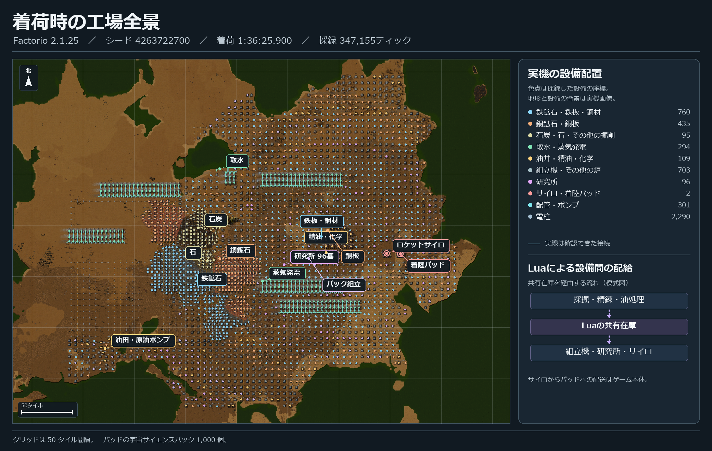

# AIにファクトリオを1時間40分以内にクリアしてもらう方法

[English](README.en.md) · [简体中文](README.zh-Hans.md)

Factory Launch Project の公開候補 **v0.2.0-rc.1**。Steam版 **Factorio 2.1.25（ビルド88022）** の基本ゲームを、固定シード **4263722700** の新規マップからロケットの打ち上げと衛星からの荷物の受け取りまで自動で進める。プロジェクトの最速は、ゲーム内 **1:34:05.300** にロケットの上昇完了、**1:34:14.783** にスペースサイエンスパック1,000個が着荷。開発中の同一シード・同一ビルドでの着荷 **1:50:50.017** から **16分35.233秒** 短縮した。 [タイムの比較](evidence/timing-history.json) · [公開候補の検証](evidence/release-verification.json)

設計、実装、試走、検証、文書化まで、**ChatGPTがほぼすべての仕事を行いました。** ユーザーは目標を設定し、参考RTAと改善案を提示し、ゲーム画面や実績を確認した。

このチャットの作業記録を追記した時点の設定は **GPT-6.2 Sol／ウルトラ**。ユーザー申告の週間利用枠の使用量は **合計約43%** で、案件単独の使用量は未計測。**2026年11月22日〜25日（日本時間）** に試行・再生・検査でFactorio本体を起動した記録は **約690回（693件）**。公開候補の再生を含め、自動試走モードの起動は **107件**。 [日別内訳と集計方法](運用と開発の記録.md)

| 実測 | ロケットの上昇完了または勝利 | パッド在庫1,000個の確認 |
|---|---:|---:|
| 公開候補のヘッドレス再生 | **1:34:05.300** · 338,718ティック | **1:34:14.783** · 339,287ティック |
| 以前のヘッドレス基準 | 1:34:07.583 · 338,855ティック | 1:34:17.067 · 339,424ティック |
| 撮影用ルートの画面付き再生 | **1:36:16.417** · 346,585ティック | **1:36:25.900** · 347,154ティック |
| 同梱セーブからの手動発射 | **1:37:30** · 勝利画面の表示 | 「続行」後に1,000個を確認 |
| 旧セーブでのSteam実績再取得試験 | **1:38:14** · 勝利画面の表示 | 「続行」後に1,000個を確認 |

自動再生はワールド開始からのゲーム内時間。今回のヘッドレスルートは新規マップからの2走で223件のイベントと生産・消費の集計が一致した。画面付きは撮影用の別ルートで、画面上の自動運転タイマーはワールド開始より後に起点を置く。手動発射の勝利画面には、準備済みセーブの保存前のゲーム内時間も含まれる。実機の経過時間は再走ごとに記録した。 [最速ルートの2走](evidence/iron-allocation-55-comparison.json) · [以前のヘッドレス再走](evidence/replays.json) · [画面付きの実測](evidence/visible-capture.json) · [Steamでの実績再取得](evidence/steam-recheck.json)



画面付き試走で1,000個が入った直後の工場。東側にサイロと降着パッド、中央寄りに研究所がある。配置データの物理接続は配管587件、ベルト0件。矢印の給材はLuaが設備間で移した品目の流れを描いたもの。 [撮影記録](evidence/visible-capture.json)

## AI・人間向けの固定再生

Windows、上記ビルドのFactorio、Python 3.11以上を用意する。手元の検証はPython 3.12.16で実施した。ZIPを書き込み可能な場所へ展開し、PowerShellでこのフォルダーを開く。各サブフォルダー名を保つ。`python --version` で使うPythonを確認し、Microsoft Storeが開く場合はインストール済みの `python.exe` のフルパスを使う。固定再生はPython標準ライブラリで動く。

```powershell
python ./check_kit.py
python ./4263722700_AI別運用/operate.py replay --id replay-01
python ./4263722700_AI別運用/operate.py status --id replay-01
python ./4263722700_AI別運用/operate.py practice
```

- `check_kit.py` は実行ファイルのビルド、両ルートの入力、同梱セーブのSHA-256を確認する。`replay` は新規マップを生成して着荷の検証まで進める。別のターミナルから `status` に同じIDを渡す。標準のSteamインストール先以外なら `check_kit.py`、`replay`、画面付きの `check` と `visible` に `--factorio "D:\Games\Factorio\bin\x64\factorio.exe"` を足す。
- **終了コード0** で `state=matched`、`landing_pad_space_science=1000`、`delivery_world_tick=339287` を確認すれば再生成功。出力の `timing_s` は実機秒。
- **終了コード2** は起動・進行中・証拠待ち。元のIDで状態を確認する。プロセスが終わっても証拠が足りない場合は `4263722700_工数改善/results/<ID>/summary.json` と同フォルダーの検証ログを確認する。**終了コード1** は不一致または失敗。理由を確認し、再試行では未使用のIDを付ける。
- `practice` は四つの模擬ケースを出す。端末を使えないAIにはこの出力か、実行者が取得した状態JSONを渡す。キットの初期検証ではCodexで固定再生と教材の判定を確認した。 [初期の模擬判定](evidence/ai-operation-checks.json) · [運用と開発の記録](運用と開発の記録.md)

### Factorioの画面を見ながら再生

```powershell
python "./画面付き走行/run_route.py" check
python "./画面付き走行/run_route.py" visible demo-01
python "./画面付き走行/run_route.py" report demo-01 --require-delivery
```

このランナーはカメラと撮影処理を含む。開始時に `launched` が出たらゲーム側の進行を見る。勝利画面では「続行」を選ぶ。`--require-delivery` 付きの照会では、順序どおりの発射・勝利・配送の記録が揃い、360,000ティックより前にパッド在庫が1,000個ちょうどになれば `delivery-verified`（終了コード **0**）を返す。証拠待ちの `awaiting-delivery` は **2**、矛盾や時間超過は **1**。待機中は同じ走行名で照会する。フラグを省略した `report` の `goal-met` は勝利時に出る。ヘッドレス用のティック照合は上の固定再生を使う。 [着荷判定の試験](evidence/visible-delivery-report.json)

撮影修正版では、採掘地点の座標を `position` と `drill` の両方から読めるようにした。着荷後、走行フォルダーの `script-output` に工場全景・研究所・サイロ周辺のPNGと `factory-layout.json` が出る。表題改訂版では、新規マップから着荷までの通し走行で、撮影もその場で完了した。 [現行ルートの再走記録](evidence/development-and-validation.json) · [初回の通し走行と撮影修正](evidence/visible-zip-replay.json)

## 人が手動で発射する手順とSteam実績

同梱の発射直前セーブを、Windowsの標準のセーブ先 `%APPDATA%\Factorio\saves` にZIPのままコピーする。Steam版Factorio 2.1.25の基本ゲームのみを有効にし、タイトルの「シングルプレイ」から「ゲームをロード」でそのセーブを開く。 [発射直前セーブ](saves/4263722700-manual-neutral-ready.zip)

開始地点の右にあるロケットサイロを開く。ロケットが100%、衛星が1個、自動発射がオフであることを確認し、「打ち上げ」を押す。勝利画面で「続行」を選び、サイロ東側のカーゴ降着パッドを開く。必要なら `M` でリモートビューを開く。

同梱セーブは保存済みのプレイヤー記録が0件の状態で作成した。手動発射では勝利画面に **1:37:30** が表示され、パッドにスペースサイエンスパック **1,000個** が入った。この時刻には保存前の自動準備を含む。同梱セーブでのSteam実績の新規解除は未検証。 [同梱セーブの検証記録](evidence/neutral-manual-handoff.json)

旧セーブ `4263722700-manual-operator-ready.zip` では、所有者の承認のもとで実績をリセットした後、Steamで **2026年11月24日21:52（日本時間）** に「スプーンなんてない」を再取得した。未取得のアカウントでは、発射前に実績の状態を確認し、発射後にゲーム内通知とSteamの解除日時を照合できる。 [旧セーブでの実績再取得](evidence/steam-recheck.json) · [Factorioの実績条件](https://wiki.factorio.com/Achievements#Disabling_achievements)

## 参考にした手法

旧併用案では終盤の制御基板待ちが着荷まで響いた。電子基板に回す鉄板の比率を引き上げる時点をサイロ研究の65%から55%に早めると、研究と衛星積み込みの時刻を保ったままサイロ研究完了時の制御基板が988個から1,034個に増え、基板待ちが9.400秒から0.483秒に短縮された。 [試走比較](evidence/iron-allocation-55-comparison.json)

Nefrumsの鉄・石炭と施工材の先行確保、Mazmotの段階的な工場づくりと研究中の並行施工、Zasparのまとまった増産と隣接工程からの給材、JeHorの大鉱床に寄せた採掘・精錬を参考にした。先駆者の公開資料と実走が、工程を組み直す出発点になった。この工場ではLuaが設備を座標指定で施工し、共有在庫から距離をまたいで給材する。採掘、炉、組立、発電、研究、飛行、配送はFactorio本体が処理する。時刻はこの固定シード・Lua自動運転の条件で比較する。人力RTAの順位と計時はSpeedrun.comの各カテゴリに従う。 [Factorio 2.xのAny%ランキング](https://www.speedrun.com/factorio?h=any-2-x-x&x=ndxjper2-r8rr9p28.qkem6pdq) · [Nefrumsのガイド](https://www.speedrun.com/factorio/guides/jg8lg) · [MazmotのRTA in Japan](https://rtain.jp/game-title/factorio/) · [Zasparの標準設定走](https://www.speedrun.com/factorio/runs/yvk04e8m) · [JeHorの記録](https://www.speedrun.com/factorio/runs/y8ovjjwm)

プロジェクトのコードと文書は **MITライセンス**。実演用のセーブと画像はFactorio（Wube Software）で生成した。派生版を作った場合は、ぜひ記録更新を試し、版、シード、補助操作、発射と着荷の時刻を残してほしい。 [ライセンス](LICENSE) · [検証環境](evidence/environment.json)
