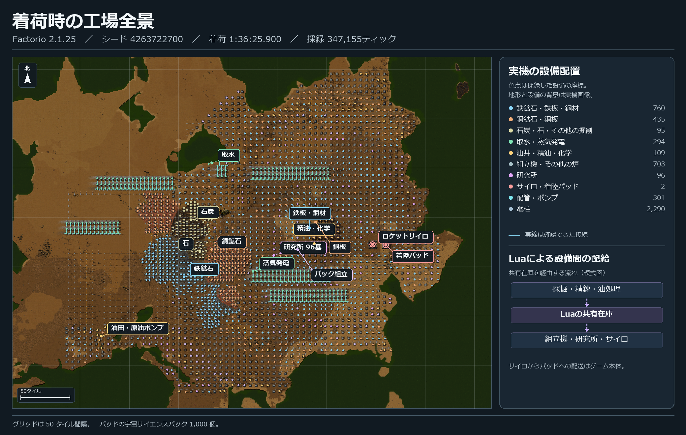

# 如何让 AI 在 1 小时 40 分钟内通关《异星工厂》

Factory Launch Project 发布候选版 **v0.2.0-rc.1**。适用于 Steam 版《异星工厂》**2.1.25（构建号 88022）**、基础游戏和地图种子 **4263722700**，从新地图开始自动发射首枚火箭并接收卫星返回的货物。项目最快一轮在游戏内 **1:34:05.300** 完成火箭升空，**1:34:14.783** 收到 1,000 个太空科技包。同一地图种子及构建版本下，此前到货用时为 **1:50:50.017**，本次缩短了 **16 分 35.233 秒**。 [用时对比](evidence/timing-history.json) · [发布候选版核验](evidence/release-verification.json)

**几乎所有工作都由 ChatGPT 完成**，包括设计、实现、试跑、核验和撰写文档。用户设定目标，提供速通参考与改进建议，并查看游戏画面和成就。

整理本记录时，此聊天使用 **GPT-6.2 Sol（Ultra 模式）**。用户报告，账户每周使用额度累计消耗约 **43%**，项目单独的用量尚未测量。**2026 年 11 月 22 日至 25 日（日本标准时间）**，日志记录了约 **690 次（693 次）**用于试跑、重放和检查的游戏启动。其中 **107 次**为脚本化测试模式启动，包含发布候选版的复跑。 [统计与核对记录](evidence/development-and-validation.json)

[日本語](README.md) · [English](README.en.md)

## 已有实测记录

| 条件 | 已实测的结果 |
| --- | --- |
| 发布候选版无界面自动运行，从新地图开始 | **1:34:05.300** 完成升空，**1:34:14.783** 到货（第 **339,287** 刻），物流接驳站中有 **1,000** 个太空科技包 |
| 早期无界面自动运行基准 | **1:34:17.067** 到货（第 339,424 刻） |
| 带画面、附加采集脚本的自动运行，从新地图开始 | 世界时间 **1:36:25.900**，第 **347,154** 刻，平台中有 **1,000** 个太空科技包 |
| 从套件所附存档手动发射 | 胜利界面显示 **1:37:30**。继续游戏后，物流接驳站收到 **1,000** 个太空科技包 |
| 使用早期存档复查 Steam 成就 | 胜利界面显示 **1:38:14**。同一 Steam 账户重置成就后重新解锁「拒绝加班」，Steam 记录为 **2026 年 11 月 24 日 21:52（日本标准时间）** |

自动运行按从新建世界起算的游戏内时间计时。无界面路线从新地图开始试跑两次，记录的 223 项事件及生产、消耗统计完全一致。带画面的是单独的采集路线，画面上的自动运行计时稍晚开始。手动发射的胜利用时包含存档前的自动准备。实际运行耗时另行记录。 [两次最快试跑](evidence/iron-allocation-55-comparison.json) · [早期无界面复跑](evidence/replays.json) · [带画面运行和采集记录](evidence/visible-capture.json) · [Steam 复查记录](evidence/steam-recheck.json) · [测试环境](evidence/environment.json)

## 从新地图复现

将套件解压到可写入的目录，在其根目录打开 PowerShell，并保留原目录名称。准备 Windows、Steam 版基础游戏 2.1.25（构建号 88022）与 Python 3.11 或更新版本。测试使用了 Python 3.12.16。用 `python --version` 确认解释器。若命令打开 Microsoft Store，请使用已安装的 `python.exe` 的完整路径。每次开始前选一个未使用的运行 ID。

```powershell
python ./check_kit.py
python ./4263722700_AI別運用/operate.py replay --id example-01
python ./4263722700_AI別運用/operate.py status --id example-01
python ./4263722700_AI別運用/operate.py practice
```

- `check_kit.py` 检查游戏构建号、两条路线的输入文件及随附存档的 SHA-256。游戏装在其他位置时，给 `check_kit.py`、`replay` 或带画面版的 `check` 和 `visible` 加上 `--factorio "D:\Games\Factorio\bin\x64\factorio.exe"`。
- `replay` 会生成新地图、运行固定路线并验证结果。
- `status` 用于在另一终端查看同一运行 ID。重复使用已有的 ID 启动新一轮时，程序会拒绝启动。
- `practice` 仅输出四个模拟案例，分别练习识别完成、进行中、输入不一致和着陆数据缺失。命令成功输出练习案例时返回 0。

对于 `replay` 和 `status`，退出码 **0** 对应 `matched`，**1** 对应 `failed`，**2** 对应 `starting`、`running` 或 `incomplete`。复现完成时应同时核对 `state: matched`、`landing_pad_space_science: 1000` 和 `delivery_world_tick: 339287`。判定还会核对版本、输入校验值和运行事件。看到胜利画面后仍有一段货物飞行时间，最后应核对实际库存。

具备终端权限的 AI 可以执行固定路线并检查结果。只能阅读文本的 AI 可以从 `practice` 或由操作人提供的日志开始。这里附有 Codex 环境下的初期验证记录。 [日志判定试验](evidence/ai-operation-checks.json)

## 可选的带画面运行

如需观看实际游戏窗口，从套件根目录运行另附的采集版。运行名用位置参数传入。

```powershell
python "./画面付き走行/run_route.py" check
python "./画面付き走行/run_route.py" visible demo-01
python "./画面付き走行/run_route.py" report demo-01 --require-delivery
```

胜利画面出现后选择「続行」（继续游戏）。使用 `--require-delivery` 时，只有发射、胜利与配送事件顺序正确，货物在第 360,000 刻之前抵达且物流接驳站库存恰为 1,000 个太空科技包，才会返回 `delivery-verified` 和退出码 **0**。退出码 **2** 表示还在等待证据，请用同一运行名继续查看。退出码 **1** 表示失败、记录不一致或超时。普通 `report` 在出现胜利画面时即可显示 `goal-met`。无界面固定路线的精确复现使用上节的 `matched` 验证器。 [配送判定试验](evidence/visible-delivery-report.json)

拍摄修正版可以从 `position` 和 `drill` 字段读取矿点坐标。货物抵达后，运行目录的 `script-output` 中会生成工厂全景、研究中心与发射井区域的 PNG，以及 `factory-layout.json`。改题版从新地图开始完整复跑，货物抵达时自动生成了三张图片。 [复跑记录](evidence/development-and-validation.json) · [早期复跑与截图修正](evidence/visible-zip-replay.json)

## 工厂全景与方法



全景来自带画面运行，货物在第 347,154 刻到达，第 347,155 刻采集图像。日文标注「研究所」指 96 座研究中心，「ロケットサイロ」和「着陸パッド」分别指火箭发射井和物流接驳站，「蒸気発電」指蒸汽发电区。图中的实线表示采集到的设备连接，本次记录到 587 段管道连接和 0 段传送带连接。右下方带箭头的方框表示 Lua 共享库存的给料流程。Lua 用已生产的材料在指定坐标施工，通过共享库存给设备供料，并管理配方与研究队列。《异星工厂》引擎处理设备生产、发电、研究、火箭飞行和实际货物到达。这里的成绩适用于固定种子、Lua 辅助、使用游戏内计时的自动运行。人力速通按各自的类别规则排名和计时。 [采集记录](evidence/visible-capture.json) · [Factorio 2.x Any% 排行榜](https://www.speedrun.com/factorio?h=any-2-x-x&x=ndxjper2-r8rr9p28.qkem6pdq)

路线参考了 Nefrums 的开局供给和施工顺序、Mazmot 在研究期间推动下一阶段施工的做法、Zaspar 的量产与相邻供料，以及 JeHor 的成片采矿和冶炼扩建。感谢这些跑者公开经验与记录。初期的采矿、冶炼和拾取试验使用 Factorio LLM Use。 [Nefrums 的指南](https://www.speedrun.com/factorio/guides/jg8lg) · [Mazmot 的 RTA in Japan 演示](https://rtain.jp/game-title/factorio/) · [Zaspar 的标准设置记录](https://www.speedrun.com/factorio/runs/yvk04e8m) · [JeHor 的记录](https://www.speedrun.com/factorio/runs/y8ovjjwm) · [Factorio LLM Use](https://github.com/Tsyklop/factorio-llm-use)

开始时为 32 座研究中心各装两个一级产能插件，货物到达时间从 **1:34:31.783** 缩短至 **1:34:17.067**。另一组组合方案让研究提前完成，发射井却等待了 9.400 秒才拿到所需的处理器。发布候选版基于该组合方案，在发射井研究达到 55% 时就将电子电路的铁板分配比例从 29% 提高到 37%。相比达到 65% 才提高比例的方案，研究完成时可用的处理器由 **988 个增至 1,034 个**，发射井等待缩短至 **0.483 秒**。 [早期改进试验](evidence/improvement-comparison.json) · [最新供给对比](evidence/iron-allocation-55-comparison.json)

## 手动发射与 Steam 成就核对

将发射前的存档 ZIP 复制到 Windows 默认的存档目录 `%APPDATA%\Factorio\saves`。在 Steam 版《异星工厂》2.1.25（构建号 88022）中仅启用基础游戏，从单人模式的存档列表载入。打开角色身旁的火箭发射井，确认火箭进度为 100%、已装载 1 颗卫星、自动发射已关闭，然后点击「发射」。进入胜利界面后选择「继续游戏」，查看发射井东侧的物流接驳站，必要时按 `M` 使用远程视图。 [发射前存档](saves/4263722700-manual-neutral-ready.zip)

套件所附存档没有预存玩家记录。手动测试中，胜利界面显示 **1:37:30**，物流接驳站收到 **1,000** 个太空科技包。显示的用时包含保存前的自动准备阶段。该存档能否在 Steam 新解锁成就仍待核实。 [手动发射实测记录](evidence/neutral-manual-handoff.json)

早期测试使用的是 `4263722700-manual-operator-ready.zip`。经账户所有者同意重置成就后，Steam 于 **2026 年 11 月 24 日 21:52（日本标准时间）** 再次记录「拒绝加班」（There is no spoon）解锁。如果你的账户尚未获得该成就，可以在发射前核对状态，发射后对照游戏通知与 Steam 的解锁记录。 [早期 Steam 复查记录](evidence/steam-recheck.json) · [Factorio 成就条件](https://wiki.factorio.com/Achievements#Disabling_achievements)

项目代码和文档采用 MIT 许可证。演示存档和截图由《异星工厂》（Wube Software）生成。欢迎在修改路线后尝试刷新记录，并注明游戏版本、种子、辅助方式、发射和货物抵达时刻。 [许可证](LICENSE)
